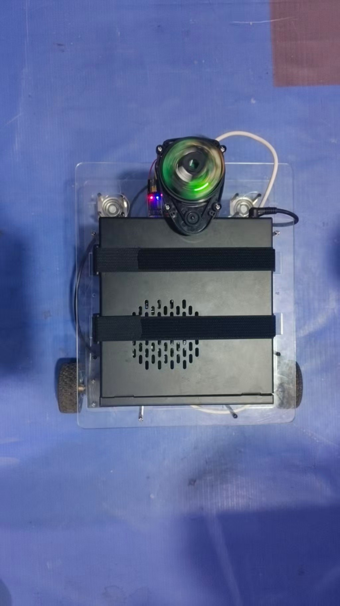
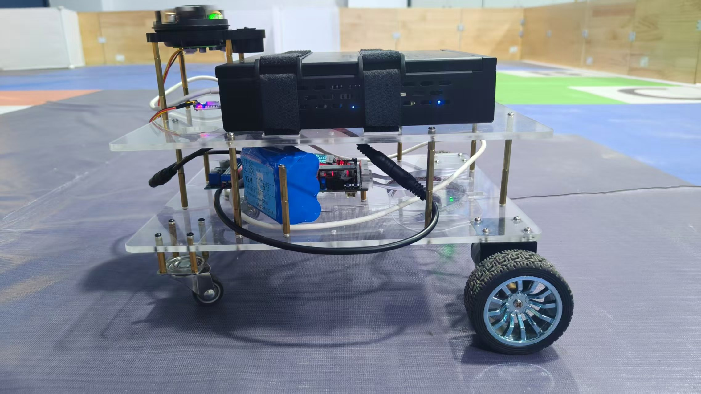
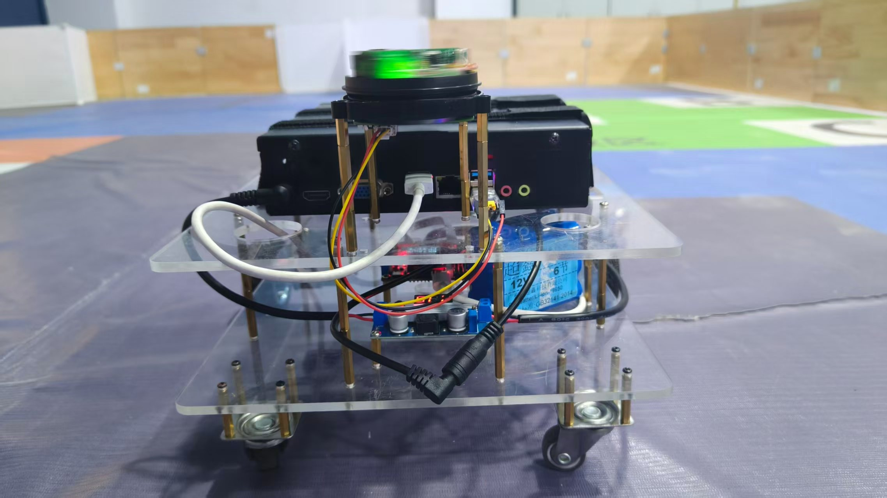

# ROS 导航与人员跟随小车

一台基于 ROS Noetic 的室内两轮差速移动机器人，完成激光建图、地图导航、多点导航和人员跟随，本仓库包含完整的项目文档、自研代码（人员跟随节点、雷达驱动修复）以及相对轮趣官方源码的修改补丁，可按文档从零复刻。

| 俯视图 | 侧视图 | 后视图 |
|---|---|---|
|  |  |  |

实测情况：多点导航一次约 2 分 42 秒、过程无碰撞；人员跟随功能完成并可演示。系统的主要不足（建图转弯重影、雷达有效量程受限）在[故障排查](docs/troubleshooting.md)中有分析。

> 本项目使用 [6-robot/waterplus_map_tools](https://github.com/6-robot/waterplus_map_tools) 管理航点并执行连续导航任务，已完成真实小车无碰撞演示。可直接查看[演示视频](media/README.md)、[多点导航运行命令](docs/commands.md#多点导航)和[插件源码仓库](https://github.com/6-robot/waterplus_map_tools)。

> 这是一个真实硬件项目的复现记录，不是开箱即用的仿真包。轮趣底盘官方源码(可直接向官方索取）、地图文件和 YOLO 权重没有直接放进仓库，需要按下文说明准备。

## 核心功能

- **多点导航（重点）**：使用 `waterplus_map_tools` 保存、读取航点，并调用 `move_base` 按顺序完成连续导航。
- Camsense X1 激光雷达发布 `/scan`（含无效点 NaN 修复），底盘发布轮式里程计 `/odom`（实车校准系数 `odom_x_scale=1.022`、旋转 `1.019`）。
- 使用 gmapping 建立二维栅格地图，并通过 `map_server` 保存地图。
- 使用 AMCL 与 `move_base` 在已保存地图上定位和导航，支持单点与多点（航点文件）任务。
- 底盘固件带 ROS/UART3 通信约 300 ms 超时停车逻辑。
- Logitech C930c 摄像头 + YOLOv8n ONNX 模型检测人员并控制小车低速跟随，带丢失搜索与雷达避障。

## 硬件与软件

| 部件 | 配置 |
|---|---|
| 底盘 | Wheeltec C30D mini_diff，两轮差速 + 万向轮，轮距实测约 0.30 m |
| 电机 | JGB37-520，12 V、530 RPM、19:1，霍尔编码器（11 线，836 计数/圈） |
| 控制板 | C30D V2.0，STM32F407VET6，板载 ICM20948（当前未融合 IMU） |
| 激光雷达 | Camsense X1，`/scan` 约 5.2 Hz、400 点/圈，量程上限约 8 m |
| 上位机 | x86 小主机（J3160，4 GB / 128 GB），Ubuntu 20.04 + ROS Noetic |
| 摄像头 | Logitech C930c |
| 建图与导航 | gmapping、AMCL、move_base |

TF 主链：`map -> odom_combined -> base_footprint -> laser`（`base_footprint -> laser` 静态 TF 约 `(0.12, 0, 0.127)` m）。整体软件结构见[软件架构](docs/architecture.md)。

## 仓库结构

```text
├── README.md
├── LICENSE                        MIT（覆盖本仓库自有内容，许可边界见下）
├── docs/
│   ├── hardware.md                硬件参数、供电与接线
│   ├── firmware.md                固件参数配置（改哪里、改什么）
│   ├── ros-setup.md               Ubuntu/ROS 环境、udev、驱动编译
│   ├── bringup.md                 从机械装配到建图导航的完整流程
│   ├── architecture.md            软件架构与技术总结
│   ├── person-follow.md           人员跟随原理与调参
│   ├── troubleshooting.md         故障排查与备选方案
│   └── commands.md                实际运行过的常用命令
├── src/
│   ├── camsense_driver/           Camsense X1 驱动（BSD 3-Clause，含无效点修复）
│   └── person_follow/             标准 catkin 人员检测与跟随包（MIT）
├── patches/
│   ├── firmware-c30d-r550.patch   固件全部修改（应用在轮趣官方 Keil 工程上）
│   ├── ros-noetic-c30d.patch      ROS 侧全部修改（应用在官方源码包上）
│   └── README.md                  补丁应用方法与内容清单
├── media/                         实车照片与后续演示媒体
└── reports/                       技术报告
```

## 快速开始

1. **硬件**：按[硬件与接线](docs/hardware.md)装配底盘、雷达、主机和摄像头，完成供电与接线检查。
2. **获取官方源码**：从轮趣（WheelTEC）官方渠道获取
   - 固件 Keil 工程：`R550_C30D(2.0)_Mini小车STM32源码_霍尔编码器_2025.12.26`（注意车型和日期，不同车型工程不能混用，见[固件参数配置](docs/firmware.md)）；
   - ROS Noetic 源码：含 `turn_on_wheeltec_robot`、`wheeltec_robot_rc`、`waterplus_map_tools`、`rf2o_laser_odometry`。多点导航使用 [6-robot/waterplus_map_tools](https://github.com/6-robot/waterplus_map_tools) 航点插件，来源和许可说明见[常用命令](docs/commands.md)。
3. **固件**：在 Keil 工程根目录应用 `patches/firmware-c30d-r550.patch`，按[固件参数配置](docs/firmware.md)核对参数后编译烧录。
4. **ROS 环境**：按[ROS 环境搭建](docs/ros-setup.md)装好 Ubuntu 20.04 + ROS Noetic，在 `catkin_ws/src` 应用 `patches/ros-noetic-c30d.patch`，再把本仓库的 `src/camsense_driver/` 和 `src/person_follow/` 放进 `catkin_ws/src`，执行：

   ```bash
   cd ~/catkin_ws
   rosdep install --from-paths src --ignore-src -r -y
   catkin_make
   source devel/setup.bash
   ```

   `person_follow` 已经是标准 catkin 包，检测节点和跟随节点可以用 `rosrun` 或仓库内的 launch 文件启动。
5. **建图与导航**：按[复刻流程](docs/bringup.md)完成底盘联调、里程计校准、gmapping 建图、地图保存和 move_base 导航；多点航点操作见[常用命令](docs/commands.md)。
6. **人员跟随**：导出 YOLOv8n ONNX 模型后按[人员跟随](docs/person-follow.md)运行检测与跟随节点；没有模型时也可以先使用 HOG 版本验证控制链路。

## 许可说明

- 本仓库自有内容（`docs/`、`src/person_follow/`、`patches/`、`media/`、配置与文档）：**MIT License**，见 [LICENSE](LICENSE)。
- `src/camsense_driver/`：来自上游开源项目（BSD 3-Clause，Copyright (c) 2020, Bram Fenijn），本项目在其基础上修复了无效回波处理，原 LICENSE 文件保留在包内。
- 轮趣（WheelTEC）官方源码版权归轮趣所有：本仓库不包含、也不再分发其源码，只提供修改补丁；将补丁应用到你合法获取的官方源码后，仍需遵循官方许可。
- YOLOv8n 权重与训练代码遵循 Ultralytics **AGPL-3.0**：本仓库不分发 `.pt`/`.onnx` 权重，请按[人员跟随](docs/person-follow.md#模型导出)自行导出。

## 作者

fei-yv · 2026
